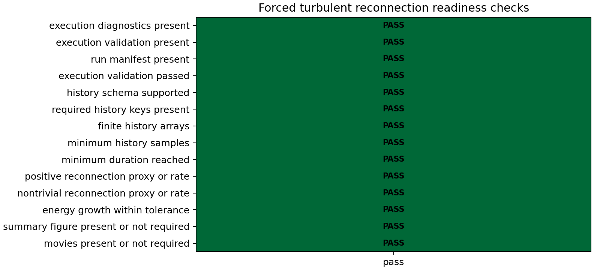
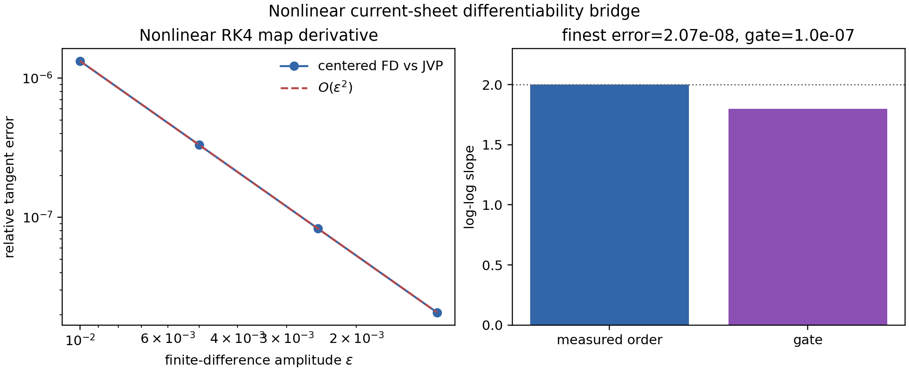
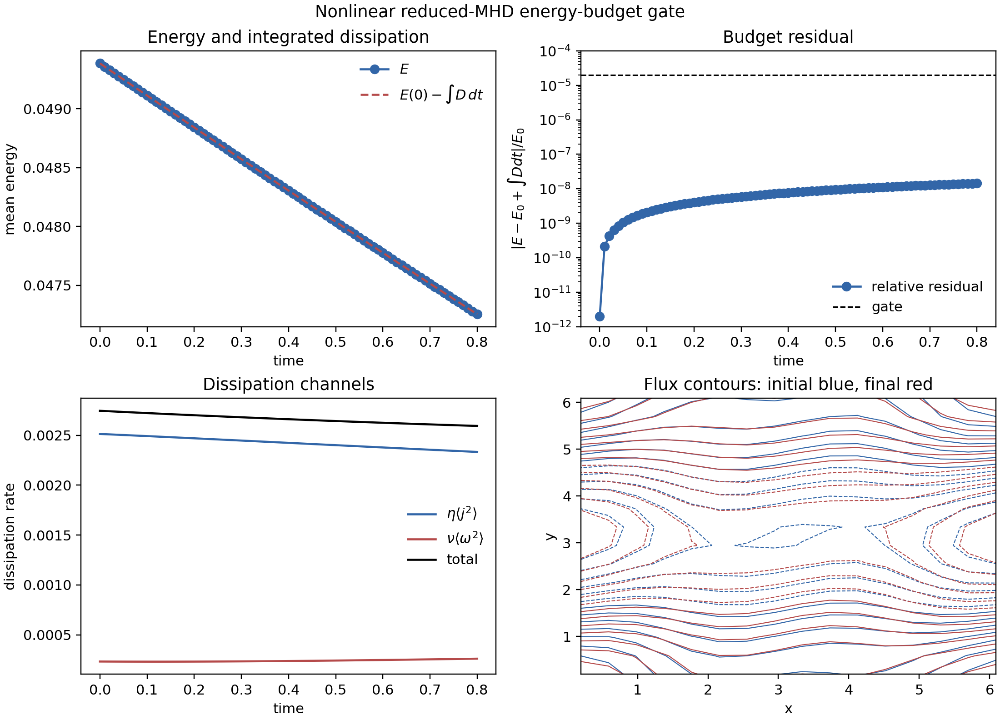
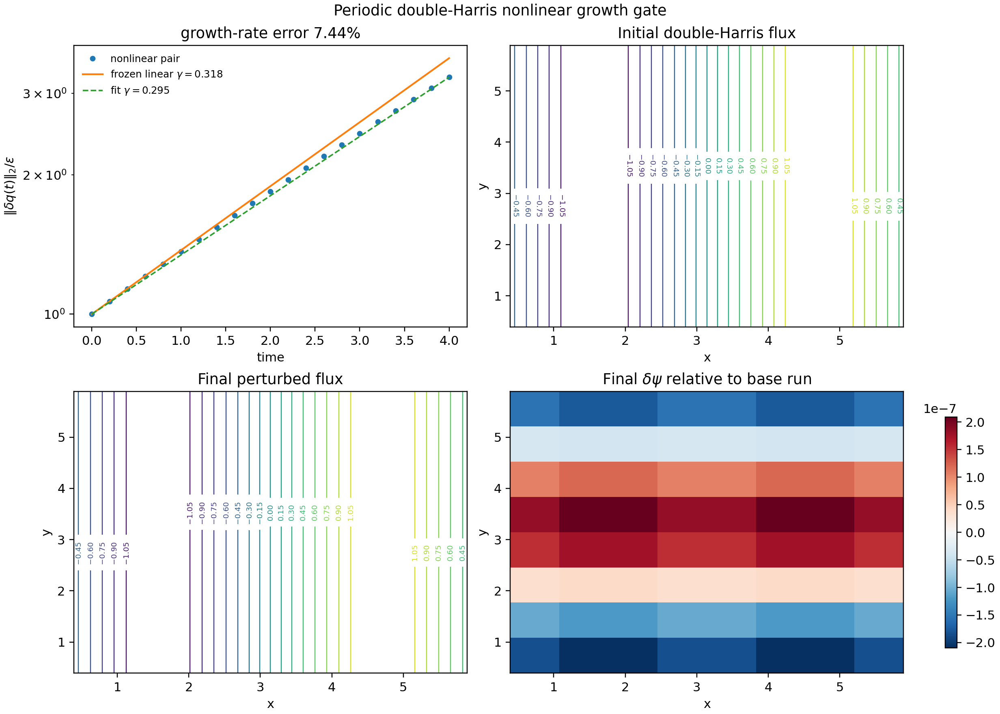
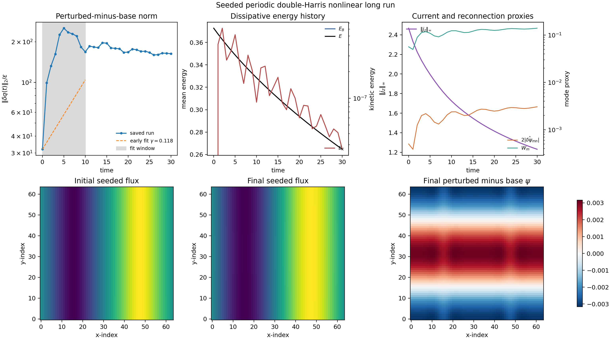
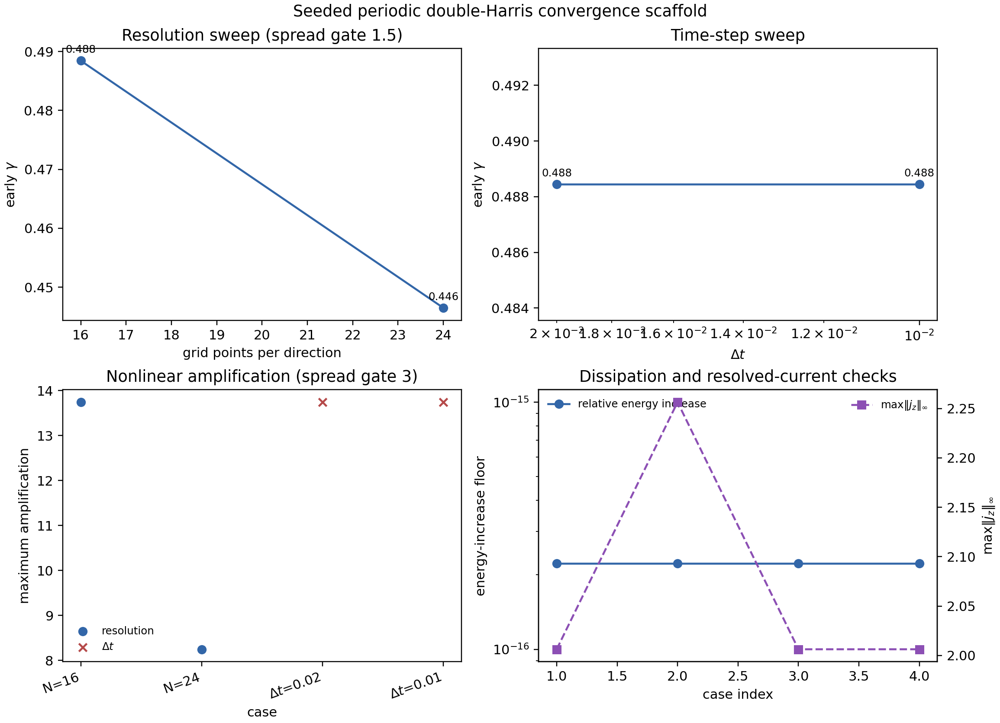
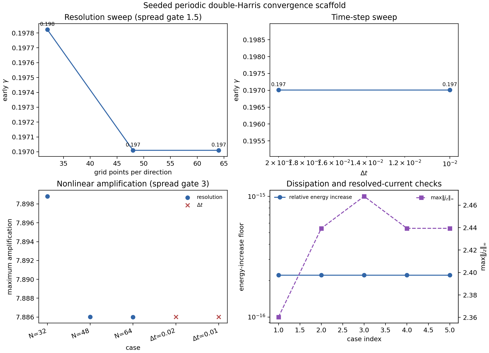
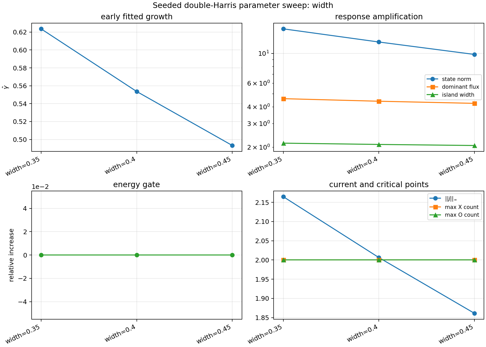

# Nonlinear gates

## Nonlinear Orszag--Tang reduced-MHD gate

MHX includes a solver-generated nonlinear Orszag--Tang validation case:

```bash
mhx benchmark orszag-tang --outdir outputs/benchmarks/orszag_tang_vortex --movies
```

The initial condition adapts the classic
[Orszag--Tang two-dimensional MHD vortex](https://doi.org/10.1017/S002211207900210X)
to the incompressible reduced-MHD variables:

$$
\phi=\cos x+\cos y,\qquad
\psi=\cos y+\frac{1}{2}\cos 2x,
$$

giving

$$
\mathbf{v}_\perp=(-\sin y,\sin x),\qquad
\mathbf{B}_\perp=(-\sin y,\sin 2x).
$$

The validation checks finite fields, monotone resistive-viscous energy decay,
net dissipation, high-wavenumber growth in current density and vorticity, and
spectral preservation of $\nabla\cdot\mathbf{B}_\perp=0$. This is not a
compressible full-MHD shock benchmark; it is the nonlinear reduced-MHD example
used by the README media and extension tutorials.

Expected files:

- `outputs/benchmarks/orszag_tang_vortex/diagnostics.json`
- `outputs/benchmarks/orszag_tang_vortex/validation.json`
- `outputs/benchmarks/orszag_tang_vortex/orszag_tang_vortex.npz`
- `outputs/benchmarks/orszag_tang_vortex/figures/orszag_tang_summary.png`
- `outputs/benchmarks/orszag_tang_vortex/figures/orszag_tang_current.gif`
- `outputs/benchmarks/orszag_tang_vortex/figures/orszag_tang_vorticity.gif`

## Decaying turbulence and forced turbulent reconnection

The turbulence validations exercise nonlinear advection, current-sheet
formation, and reconnection-proxy diagnostics without claiming converged
turbulent reconnection rates. The reduced-MHD equations remain

$$
\partial_t\psi + [\phi,\psi] = \eta\nabla^2\psi,
\qquad
\partial_t\omega + [\phi,\omega] = [\psi,\nabla^2\psi]
  + \nu\nabla^2\omega + F_\omega ,
$$

where the decaying case sets $F_\omega=0$ and the forced current-sheet case
uses a weak deterministic large-scale vorticity forcing. The decaying gate
checks finite arrays, total-energy decay, current amplification, and high-$k$
transfer. The forced gate checks finite arrays, bounded injected energy,
current amplification, and a reconnection proxy built from X/O critical-point
flux separation when available, with a documented max-min flux fallback.

Run the validations:

```bash
mhx benchmark decaying-turbulence --outdir outputs/benchmarks/decaying_mhd_turbulence --movies
mhx benchmark forced-turbulent-reconnection --outdir outputs/benchmarks/forced_turbulent_reconnection --movies
mhx benchmark forced-turbulent-reconnection-readiness-check outputs/benchmarks/forced_turbulent_reconnection
```

Expected files:

- `outputs/benchmarks/decaying_mhd_turbulence/decaying_mhd_turbulence.npz`
- `outputs/benchmarks/decaying_mhd_turbulence/figures/decaying_mhd_turbulence_summary.png`
- `outputs/benchmarks/forced_turbulent_reconnection/forced_turbulent_reconnection.npz`
- `outputs/benchmarks/forced_turbulent_reconnection/figures/forced_turbulent_reconnection_summary.png`
- `outputs/benchmarks/forced_turbulent_reconnection/readiness/promotion_readiness.json`
- `outputs/benchmarks/forced_turbulent_reconnection/readiness/figures/promotion_matrix.png`
- optional flux/current GIFs under each `figures/` directory

The readiness matrix is a validation-only claim boundary for the forced
current-sheet replay. It requires finite histories, enough saved samples,
minimum duration, nontrivial reconnecting-flux or reconnection-rate proxy,
bounded total-energy growth, and the expected summary/movie artifacts.



These examples are literature-anchored to 2-D MHD turbulence and
turbulent-reconnection studies, including the current-sheet/turbulence
diagnostic tradition used by Servidio and collaborators and the broader
Lazarian--Vishniac picture of turbulence-assisted reconnection. The current
MHX examples are pedagogical 2-D reduced-MHD validation artifacts, not 3-D
fast-reconnection production evidence.

Source links:

- [Turbulence implementation](https://github.com/uwplasma/MHX/blob/main/src/mhx/benchmarks/turbulence.py)
- [Critical-point diagnostics](https://github.com/uwplasma/MHX/blob/main/src/mhx/diagnostics/critical_points.py)
- [Turbulence tests](https://github.com/uwplasma/MHX/blob/main/tests/test_turbulence_validation.py)

## Nonlinear current-sheet differentiability bridge

The linear replay gate validates a frozen operator. The next differentiable
solver gate validates the nonlinear RK4 time map used by actual MHX runs. Let
$\Phi(q_0)$ be the map from an initial reduced-MHD state to the saved trajectory
vector after several RK4 steps. Around the periodic current sheet
$q_0=(\psi_0,\omega_0)$, JAX gives a tangent

$$
\delta \Phi = D\Phi(q_0)[p].
$$

MHX compares that tangent to centered finite differences of full nonlinear
trajectories:

$$
\delta \Phi_\epsilon =
\frac{\Phi(q_0+\epsilon p)-\Phi(q_0-\epsilon p)}{2\epsilon}.
$$

For a smooth RHS and x64 arithmetic, the error should converge as

$$
\frac{\|\delta \Phi_\epsilon-\delta\Phi\|_2}{\|\delta\Phi\|_2}
= O(\epsilon^2)
$$

until roundoff. This gate is specifically aimed at differentiable programming
claims: before MHX runs adjoints or inverse-design loops on solver
trajectories, the trajectory map itself must have a verified tangent.

```bash
mhx benchmark current-sheet-nonlinear-bridge \
  --outdir outputs/benchmarks/periodic_current_sheet_nonlinear_bridge
```

Expected files:

- `outputs/benchmarks/periodic_current_sheet_nonlinear_bridge/diagnostics.json`
- `outputs/benchmarks/periodic_current_sheet_nonlinear_bridge/validation.json`
- `outputs/benchmarks/periodic_current_sheet_nonlinear_bridge/periodic_current_sheet_nonlinear_bridge.npz`
- `outputs/benchmarks/periodic_current_sheet_nonlinear_bridge/figures/periodic_current_sheet_nonlinear_bridge.png`



## Nonlinear reduced-MHD energy budget

The first full nonlinear PDE gate is deliberately not a plasmoid claim. It
checks the periodic reduced-MHD energy theorem under the complete nonlinear
Poisson-bracket RHS. For

$$
E(t)=\frac{1}{2}\left\langle |\nabla\psi|^2+|\nabla\phi|^2\right\rangle,
\qquad \nabla^2\phi=\omega,\qquad j=-\nabla^2\psi,
$$

periodic integration by parts gives

$$
\frac{dE}{dt}=-\eta\langle j^2\rangle-\nu\langle\omega^2\rangle.
$$

This identity is a strong nonlinear sign/cancellation check: the advection and
magnetic-tension brackets must cancel in the energy balance, while the
resistive and viscous terms must remove energy. MHX starts from a multi-mode
state with active nonlinear RHS, advances the full nonlinear RK4 solver, and
gates:

- all saved arrays are finite;
- the initial nonlinear RHS norm is a nontrivial fraction of the full RHS;
- total energy is nonincreasing;
- the integrated residual
  $|E(t)-E(0)+\int_0^t[\eta\langle j^2\rangle+\nu\langle\omega^2\rangle]dt|/E(0)$
  stays below tolerance;
- net dissipative energy loss is observed.

```bash
mhx benchmark nonlinear-energy-budget \
  --outdir outputs/benchmarks/nonlinear_energy_budget
```

Expected files:

- `outputs/benchmarks/nonlinear_energy_budget/diagnostics.json`
- `outputs/benchmarks/nonlinear_energy_budget/validation.json`
- `outputs/benchmarks/nonlinear_energy_budget/nonlinear_energy_budget.npz`
- `outputs/benchmarks/nonlinear_energy_budget/figures/nonlinear_energy_budget.png`



This is the most important nonlinear solver gate currently in MHX. It supports
claims about nonlinear reduced-MHD consistency, but it still does not validate
nonlinear island growth, Rutherford saturation, Sweet--Parker reconnection
rates, or plasmoid chains.

## Reconnection campaign evidence

### Periodic double-Harris nonlinear growth gate

The stable cosine-current-sheet spectrum above is intentionally conservative:
it protects the code from spurious positive growth but does not demonstrate
tearing. MHX now adds a small-grid instability gate using a periodic
double-Harris sheet,

$$
B_y(x)=A\left[\tanh\left(\frac{x-L_x/4}{a}\right)
-\tanh\left(\frac{x-3L_x/4}{a}\right)-1\right],
$$

with a zero-mean flux $\psi_0$ satisfying $B_y=\partial_x\psi_0$ to the sign
convention used by the reduced-MHD solver. The gate assembles the dense
matrix-free Jacobian $L=D F(\psi_0,0)$, selects the fastest non-gauge unstable
eigenmode $Lv=\gamma v$, and advances two full nonlinear trajectories:

$$
q_b(t)=\Phi_t(q_0),\qquad
q_p(t)=\Phi_t(q_0+\epsilon v).
$$

The measured finite-amplitude difference

$$
A(t)=\frac{\|q_p(t)-q_b(t)\|_2}{\epsilon}
$$

must grow by more than a factor of two and its fitted rate must remain within a
documented tolerance of the frozen-base eigenvalue. This is the first MHX
validation artifact that shows a physically unstable current sheet growing in
the nonlinear solver. It is still **not** a Rutherford-island or plasmoid-chain
production claim: the grid is deliberately tiny, the base sheet is periodic,
and publication claims still require duration, resolution, time-step, seed, and
aspect-ratio sweeps. The literature anchors are the classical tearing-mode
instability of Furth--Killeen--Rosenbluth
([Physics of Fluids 6, 459, 1963](https://cir.nii.ac.jp/crid/1363107370207531008))
and the high-Lundquist-number plasmoid-chain scalings of
Loureiro--Schekochihin--Cowley
([arXiv:astro-ph/0703631](https://arxiv.org/abs/astro-ph/0703631)), with
later nonlinear plasmoid-chain simulations by Samtaney et al.
([arXiv:0903.0542](https://arxiv.org/abs/0903.0542)).

```bash
mhx benchmark double-harris-growth \
  --outdir outputs/benchmarks/periodic_double_harris_nonlinear_growth
```

Expected files:

- `outputs/benchmarks/periodic_double_harris_nonlinear_growth/diagnostics.json`
- `outputs/benchmarks/periodic_double_harris_nonlinear_growth/validation.json`
- `outputs/benchmarks/periodic_double_harris_nonlinear_growth/periodic_double_harris_nonlinear_growth.npz`
- `outputs/benchmarks/periodic_double_harris_nonlinear_growth/figures/periodic_double_harris_nonlinear_growth.png`



### Seeded double-Harris long-run validation

The dense eigenmode gate above is intentionally tiny because it assembles the
full Jacobian. The next bridge is a scalable nonlinear run that does **not**
assemble the dense spectrum. It advances a base periodic double-Harris sheet
and a seeded sheet,

$$
q_b(t)=\Phi_t(q_0),\qquad
q_s(t)=\Phi_t(q_0+\epsilon\cos(2x)\cos y),
$$

and tracks the normalized difference, dominant reconnecting-flux proxy, local
Rutherford-width proxy, total energy, kinetic energy, peak current density, and
X/O critical-point counts:

$$
A_s(t)=\frac{\|q_s(t)-q_b(t)\|_2}{\epsilon},\qquad
\psi_\mathrm{rec}(t)=2\max_{0<|k_i|\le N_i/4}|\widehat{\delta\psi}_k(t)|,
\qquad
W_m(t)=4\sqrt{\frac{|\psi_\mathrm{rec}(t)|}{|A|/a}},
\qquad
E(t)=\frac{1}{2}\langle |\nabla\psi|^2+|\nabla\phi|^2\rangle,\qquad
\|j_z\|_\infty=\|-\nabla^2\psi\|_\infty .
$$

This command is meant for bounded nonlinear evidence runs under laptop/CI
budgets and for producing reviewer-visible movies before a full production
campaign. It gates finite histories, full-duration completion, an early-time
growth fit, visible maximum amplification, and dissipative total-energy
behavior. The reconnection proxy is deliberately stated as a **dominant
low-mode perturbation-flux diagnostic** for periodic double-Harris validation:
the configured seed-mode amplitude is archived separately as
`seed_mode_reconnected_flux`, so mode transfer is visible rather than hidden.
The committed `64×64`, `t_end=30` evidence bundle gives
`gamma_early = 0.118`, early amplification `5.27×`, maximum amplification
`7.89×`, and zero measured total-energy increase. The result is stronger than
a smoke test, but it remains a validation artifact rather than a converged
Rutherford/plasmoid claim because the late-time perturbation saturates/relaxes
and no resolution/seed/aspect-ratio sweep has yet closed.

```bash
mhx benchmark double-harris-long-run \
  --outdir outputs/benchmarks/periodic_double_harris_seeded_long_run \
  --nx 64 --ny 64 --t-end 30 --save-every 100 --movies
```

Expected files:

- `outputs/benchmarks/periodic_double_harris_seeded_long_run/diagnostics.json`
- `outputs/benchmarks/periodic_double_harris_seeded_long_run/validation.json`
- `outputs/benchmarks/periodic_double_harris_seeded_long_run/periodic_double_harris_seeded_long_run.npz`
- `outputs/benchmarks/periodic_double_harris_seeded_long_run/figures/periodic_double_harris_seeded_long_run.png`
- `outputs/benchmarks/periodic_double_harris_seeded_long_run/figures/periodic_double_harris_flux.gif`
- `outputs/benchmarks/periodic_double_harris_seeded_long_run/figures/periodic_double_harris_current.gif`

Once a convergence bundle exists, the promotion-boundary report is:

```bash
mhx benchmark double-harris-promotion-check \
  outputs/benchmarks/periodic_double_harris_seeded_long_run \
  --convergence-dir outputs/benchmarks/periodic_double_harris_convergence
```

This writes `promotion/promotion_readiness.json`,
`promotion/validation.json`, and `promotion/figures/promotion_matrix.png`.
Passing means the run is convergence-backed validation evidence; it still does
not authorize Rutherford, Sweet--Parker, or plasmoid production claims.



The historical flux and current-density movies are not embedded here
because the total-field view is dominated by the static equilibrium; the
response-history figure above is the clearer validation evidence.

Source anchors:

- [double-Harris equilibrium](https://github.com/uwplasma/MHX/blob/main/src/mhx/physics/equilibria.py)
- [growth and long-run benchmark implementation](https://github.com/uwplasma/MHX/blob/main/src/mhx/benchmarks/current_sheet.py)
- [growth benchmark tests](https://github.com/uwplasma/MHX/blob/main/tests/test_current_sheet_eigenvalue_validation.py)

### Seeded double-Harris convergence evidence

This gate asks whether the measured early growth and nonlinear amplification
are artifacts of one tiny grid or one RK4 step size. The command

```bash
mhx benchmark double-harris-convergence \
  --outdir outputs/benchmarks/periodic_double_harris_convergence \
  --resolutions 16,24 --dt-values 0.02,0.01 \
  --reference-resolution 16 --t-end 8 --fit-stop 4
```

runs the same base-vs-seeded replay across a small resolution sweep and a small
time-step sweep. For each case it records

$$
\gamma_\mathrm{fit},\quad
G_\mathrm{early}=A_s(t_b)/A_s(t_a),\quad
G_\mathrm{max}=\max_t A_s(t)/A_s(0),\quad
\Delta E_+=\max_t(E(t)-E(0))_+/E(0).
$$

The gate requires finite metrics, positive early growth, dissipative total
energy, successful subcase gates, and bounded relative spread in
`gamma_fit`/`G_max`. The same code path has also been exercised on a
GPU-assisted medium sweep with resolutions `32,48,64`, `t_end=16`, and
`0.41%` growth-rate spread. This is intentionally **validation** evidence, not
a production claim: it prevents single-run overclaiming before larger
aspect-ratio, Lundquist-number, seed, and duration sweeps are executed.

Expected files:

- `outputs/benchmarks/periodic_double_harris_convergence/diagnostics.json`
- `outputs/benchmarks/periodic_double_harris_convergence/validation.json`
- `outputs/benchmarks/periodic_double_harris_convergence/periodic_double_harris_convergence.npz`
- `outputs/benchmarks/periodic_double_harris_convergence/figures/periodic_double_harris_convergence.png`





### Seeded double-Harris parameter sweeps

Convergence sweeps ask whether one numerical setting dominates the result.
Parameter sweeps ask a different question: do the nonlinear response
diagnostics remain finite, dissipative, and visibly reconnecting when the seed
mode, sheet width, or resistivity is changed? The command

```bash
mhx benchmark double-harris-parameter-sweep \
  --outdir outputs/benchmarks/periodic_double_harris_parameter_sweep \
  --sweep-axis width --widths 0.35,0.4,0.45 \
  --t-end 6 --fit-stop 3
```

runs three seeded base-vs-perturbed replays and records

$$
\gamma_\mathrm{fit},\quad
G_\mathrm{max},\quad
G_\psi=\max_t \psi_\mathrm{rec}(t)/\psi_\mathrm{rec}(0),\quad
G_W=\max_t W(t)/W(0),\quad
\Delta E_+ .
$$

The gate requires all cases to pass the underlying seeded-long-run checks, and
also requires finite per-case metrics, at least three cases, positive fitted
growth, visible amplification, reconnecting-flux and island-width response,
dissipative total energy, and bounded anomaly-scale spreads. The spread gates
are deliberately loose because physically different sheets need not agree; they
catch runaway or degenerate cases before figures are promoted.

Expected files:

- `outputs/benchmarks/periodic_double_harris_parameter_sweep/diagnostics.json`
- `outputs/benchmarks/periodic_double_harris_parameter_sweep/validation.json`
- `outputs/benchmarks/periodic_double_harris_parameter_sweep/periodic_double_harris_parameter_sweep.npz`
- `outputs/benchmarks/periodic_double_harris_parameter_sweep/figures/periodic_double_harris_parameter_sweep.png`



Source anchors:

- [convergence runner](https://github.com/uwplasma/MHX/blob/main/src/mhx/benchmarks/current_sheet.py)
- [convergence CLI](https://github.com/uwplasma/MHX/blob/main/src/mhx/cli/main.py)
- [convergence tests](https://github.com/uwplasma/MHX/blob/main/tests/test_current_sheet_eigenvalue_validation.py)
